<!-- Generated by GitHub Profile Agent Console. Edit profile.config.json, then run npm run generate. -->

  <picture>
    <source media="(max-width: 760px) and (prefers-color-scheme: dark)" srcset="./assets/hero/agent-console-21156950-mobile-dark.svg">
    <source media="(max-width: 760px)" srcset="./assets/hero/agent-console-21156950-mobile-light.svg">
    <source media="(prefers-color-scheme: dark)" srcset="./assets/hero/agent-console-21156950-dark.svg">
    <source media="(prefers-color-scheme: light)" srcset="./assets/hero/agent-console-21156950-light.svg">
    
  </picture>

  

## About Me

Saya merancang dan membangun platform web praktis yang berfokus pada antarmuka yang bersih dan pengalaman pengguna yang lancar.

Pekerjaan saya menggabungkan eksplorasi teknis dengan pola pikir seorang pembangun: memahami masalah pengguna, merancang solusi UI/UX, dan menulis kode untuk mewujudkannya.

## Current Focus

| Area | What I am exploring |
| --- | --- |
| **UI/UX Design** | Merancang alur interaksi, tata letak, dan prototipe yang intuitif untuk platform digital. |
| **Web Development** | Membangun aplikasi dan situs web yang responsif menggunakan teknologi web modern. |
| **E-commerce Systems** | Menciptakan sistem penelusuran produk dan alur transaksi toko online yang disederhanakan. |

## Featured Work

| Project | Focus | Why it matters |
| --- | --- | --- |
| [**Brothersclothes**](https://github.com/bigboyzo6/brothers-clothes) | Website and UI/UX | Situs web e-commerce pakaian full-stack yang dibangun untuk menyederhanakan penelusuran produk dan transaksi online. [Live](https://bigboyzo6.github.io/brothers-clothes/) |
| [**ImageConverter**](https://github.com/bigboyzo6/ImageConverter) | Pemrosesan File & Utilitas | Alat konversi gambar yang efisien, saat ini sedang dikembangkan menjadi utilitas konversi multi-format yang komprehensif. [Live](https://bigboyzo6.github.io/ImageConverter/) |

## Research Direction

Saya tertarik membangun aplikasi web interaktif, mulai dari toko online hingga alat pemrosesan file, dengan fokus pada kemudahan penggunaan dan fungsionalitas.

## Tech Stack

`Next.js` · `JavaScript` · `Node.js` · `HTML/CSS` · `Figma`

## Recent Activity

<!-- AUTO:ACTIVITY:START -->
- Oct 22, 2026: pushed 1 commit to [bigboyzo6/WEB-QR-Cafe](https://github.com/bigboyzo6/WEB-QR-Cafe).
- Oct 14, 2026: pushed 1 commit to [bigboyzo6/bigboyzo6](https://github.com/bigboyzo6/bigboyzo6).
- Oct 14, 2026: created a branch in [bigboyzo6/WEB-QR-Cafe](https://github.com/bigboyzo6/WEB-QR-Cafe).
- Oct 14, 2026: pushed 1 commit to [bigboyzo6/WEB-QR-Cafe](https://github.com/bigboyzo6/WEB-QR-Cafe).
- Oct 11, 2026: created a branch in [bigboyzo6/bigboyzo6](https://github.com/bigboyzo6/bigboyzo6).
- Oct 11, 2026: pushed 1 commit to [bigboyzo6/bigboyzo6](https://github.com/bigboyzo6/bigboyzo6).
<!-- AUTO:ACTIVITY:END -->

---

  Membangun sistem yang bermanfaat dan membagikan karya yang berhasil diciptakan.

